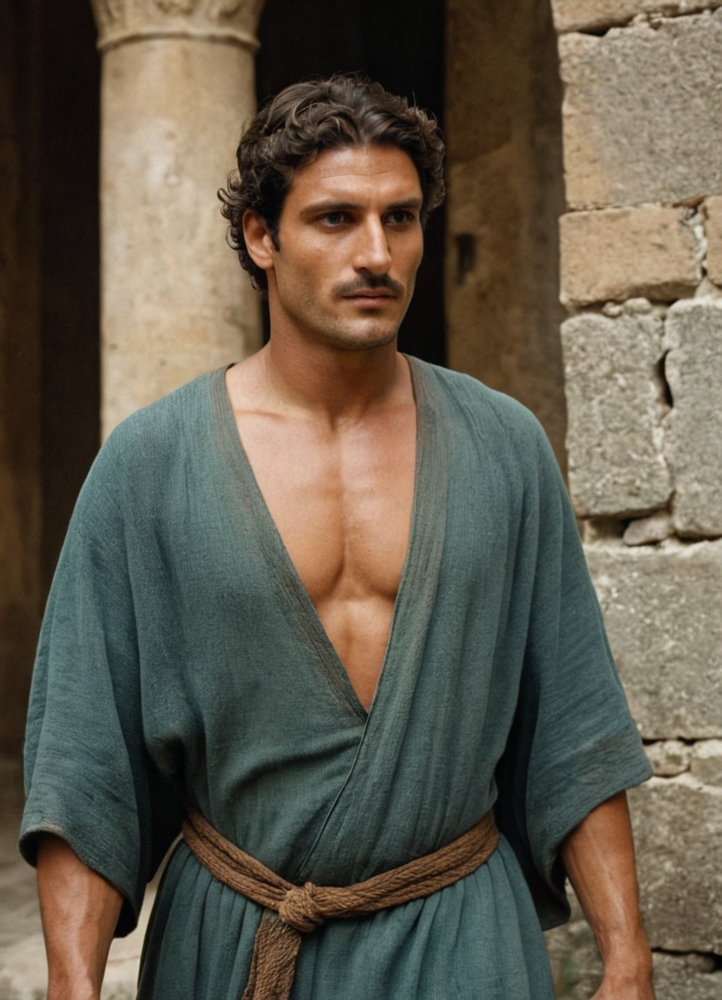
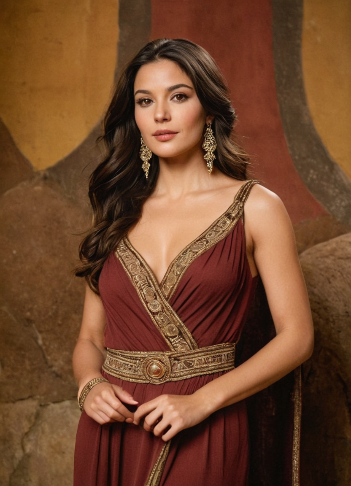

# The Atherian Empire Overview

The Atherian Empire was the great imperial civilisation of the central known world, with its capital at Caleran in the region now forming the [[01 Canon Reference/Peoples and Cultures/Thalmyric Empire/Thalmyric Empire Overview.md|Thalmyric heartland]]. Its power extended east into the lands of [[01 Canon Reference/Peoples and Cultures/Eclessia/Eclessia Overview.md|Eclessia]], around the Thalassian Sea, towards the northern desert approaches and into the southern forest marches. Roads, aqueducts, provincial institutions and urban remains continue to shape those countries in 1360 AR.

Atherian society developed over many centuries, from southern war-settlers and maritime communities through rival city-states, a republic and hereditary empire. Citizenship eventually joined populations of different ancestry within a common political system. The empire also became the setting of the Redeemer's ministry, the persecutions of his followers and the later adoption of their faith.

## Formation and expansion

Southern households and war-settlement leagues separated gradually from the post-Glass people during c. 2130–2050 BR. Their descendants seized and repaired inhabited sites, establishing themselves through conquest, slavery, alliance, adoption and intermarriage. Sea-kings, ports, mercenary leagues and founder houses later connected several regions of recovery.

Early Atherian cities grew around defensible hills, rivers and crossings in the Caleran basin and along other coasts. The [[Peoples of the Ancient Aurin|Enathi, Serathi and Vardeni]] contributed distinct Orphaned histories to the Aurin settlements; [[Arkenan and Saronikan Cities before the Empire|the eastern island cities and harbours]] developed their own trade and alliances. Competition for grain, copper, coastal access and pilgrimage traffic encouraged both war and cooperation.

Caleran's royal households emerged from the coalition of [[Avren and Caleth]]. Later, [[Ilaron and Tarsenna]] established a shared public religious settlement drawing on maritime and inland traditions. The [[The Celestial Compact and the Caleran Republic|Celestial Compact]] joined twelve leading cities around 800 BR under a common calendar, arrangements for settling disputes and a military levy. Caleran's river, harbour and road connections made it the meeting place of the league.

The Compact developed into a republic with assemblies, a senate of property-holding houses and annually chosen magistrates. Expansion brought roads, colonies and aqueducts, supported by taxes and enslaved labour. Allies gained rights on unequal terms; other subject communities paid taxes without receiving equivalent citizenship.

Land concentration, provincial wealth and competition among commanders contributed to civil war. [[Teren Casvilar]] extended Atherian power through southern conquest, took up a war-rite at the siege of Kellovar that he could never lay down, and occupied Caleran with an army he could not discharge. His rival Marovan Veyr died in sanctuary without meeting him in the field, and seven challengers killed Casvilar on the muster ground in 370 BR. His heir [[Aurelius Thalion]] refused the war-rite that had killed him, shared the government of Caleran's river stores with senior commanders and emerged from twenty years of war, without ever commanding in a battle, as supreme ruler around 350 BR. [[The Wars of the Atherian Succession]] follows that struggle, including the role of Queen Samyra's gateway kingdom. Thalion governed openly from the store-house above the muster ground, leaving the senate the city's business, and established the basis of hereditary imperial command.

[[The Rise of the Atherian Empire Overview|The rise of the empire]] explains how the republic became an empire; the [[Historical Atlas of Atheria]] connects it with earlier settlement and later imperial history.

The three and a half centuries between Thalion's settlement and the Redeemer were a long change rather than a still golden age. In 326 BR a new treasury hall at Caleran, dedicated by priests who had asked the Red Star that it stand but never loaded it, gave way during an inspection by Thalion's heir Caelor. He died of his injuries two years later, and imperial memorials remembered the prince rather than the workmen and slaves crushed beside him. Thereafter no public work could be entered until rune-trained wardens had loaded it before the Red Star and broken the "Star's share" built into it, and the official who opened a bridge or hall stood under the arch first. The custom cost lives as well as saving them: in 274 quarrymen struck rather than cut "stone for the Star to break" through the harvest, and soldiers killed them.

In 247, with Olarion dead and no heir painted on the board the armies swore to, the accession portrait in the Caleran audience hall answered questions in the Emperor's voice. Avaren Mott governed in its name for two winters. Clerks who read the grain tallies before it read them full, and no grain was bought. When it declared that no granary of the Emperor stood empty, soldiers carried it ahead of them into the poor districts to search for hoarders, and families knelt before the painted face while their stores were taken. In 245 Samor Veloran brought grain into the city, covered the Face with his cloak and refused to be painted in its place. From then on it hung veiled in the Common Sky's custody, lifted only at accessions and on the founding anniversary, and always last, while copies multiplied in governors' courts, town halls and on army standards. An emperor was now agreed by the river commands and made by standing under an arch.

The Veloran peace had its own wonders. In 219 the [[The Crown of Olveth|Crown of Olveth]] burned to death a general who wore it as a trophy. Around 200 the people of three provinces walked in their sleep through one summer, every walker in the same direction, and stopped everywhere on the same morning. The empire surveyed the trampled line and built the Via Somnia on it; the road ends at an ordinary hillside that has been dug four times and found to hold dirt. Augurs said a summons had been withdrawn, and the later Church calls the summer a foreshadowing of the pilgrim roads. The Arcelon road, tested in the dry season, slid onto its labourers in the rains, and road crews still call a fair-weather promise "tested in the dry".

When Orent II died without an heir in the fever summer of 151, the commanders remembered the Face and talked instead of marching. The spared towns of Sarqen laid their table out of season and seated their governor, Elian Halreth, in the emperor's empty place. The eastern cities backed him for citizenship, sworn before the emperor's image, and Jirahar scribes swore with the image veiled. In the Raveth hunger from 119, households whose relief debts had been sworn before the image walked their animals to the estate office unasked. Under the late Halreths a Vasharan succession war, the War of the Two Dawns, opened Qiryath to Atherian rule. The sanctuary's sign of acceptance answered one claimant's offering and gave nothing when a governor's augur demanded that it decide between rivals, and the Qiryath charter that followed kept every image out of the sanctuary. Velen I unveiled the Face at his river spectacles until untested banks drowned him with his audience. Doran I, who reached Caleran in 61, re-veiled it and had his officers enter their commands through a low door carrying a bowl. His Odrun heirs reigned when Isfir was born in a Jirahar tower town in 33 BR. Qahur's three crowns still ruled their own river at the Redeemer's birth, bound to Atheria by grain and harbour contracts.

[[Historical Atlas of the Atherian Age of Glory]] follows the empire from Thalion's later reign through [[The House of Thalion]], the Painted Reign, the Veloran and Halreth dynasties and the Odrun household reigning at 0 AR. Its companion articles explain provincial cities, armies, food, trade, slavery, education and the imperial Star cult.

## Government and provincial society

During the Age of Glory, emperors presented themselves as mediators chosen by the stars. Governors, known as Exarchs, administered provinces through relationships with treasury officials, municipal councils and temple estates. The old senate retained responsibilities in infrastructure, citizenship and commerce after losing effective command of the army.

Provincial government recorded land, counted households, organised water use and maintained grain supplies. Roads and fortified stations carried couriers, taxes, troops and goods. Municipal elites remained useful to imperial rule and often preserved local authority within it.

Incorporation changed what it meant to be Atherian. Adoption, manumission, military grants and civic admission opened different routes into the polity. Citizenship and wealth nevertheless remained unequal. Enslaved workers supported estates and construction; frontier wars destroyed local governments, displaced populations and transferred land to imperial beneficiaries.

## Cities, work and public life

Caleran accumulated forums, senate halls, palaces, observatories, warehouses, baths, theatres and burial districts. Aqueducts supplied dense populations and cultivated estates. Ports carried grain, salt, wine, metals and enslaved people between provinces. Monumental investment was concentrated in major centres, while distant communities supplied much of the labour and tax.

Mosaics, sculpture and reliefs represented battles, local histories and religious tales. Craftspeople produced jewellery, weapons and decorated buildings; patrons supported theatre, satire, athletic games and astropoetry. Schools taught rhetoric, law, mathematics, medicine, astronomy and engineering. The arts and learning of the [[The Atherian Empire – Age of Glory|Age of Glory]] survived through institutions later adopted by successor societies.

Warlock colleges developed older scripts into regulated forms of military and engineering magic. Their work supported construction, signalling, firefighting, siegecraft and controlled use of elemental forces. Some sealed laboratories remain functional, although centuries of rebuilding and looting have destroyed or opened most accessible sites.

## Religion and the Star Pantheon

Before conversion, the [[Overview of the Astratheon Religion|Astratheon religion]] organised civic cults around stars and constellations. Priests interpreted eclipses, comets and other celestial appearances as signs affecting rulers and communities. Temples served as treasuries, employers, schools and centres of public ritual.

Imperial worship brought older regional powers into a celestial hierarchy. Temple hymns called the principal powers Star Children, born of the light of Father Sun and Mother Moon. The Astral Keepers sorted the same powers into Circles by what they did rather than whom they were born to, and Folk neighbours knew several of them as courts of their own country under other names. The longest argument concerned Thanatos. Priests gathered signs of the Boatman into a star cult of theft and paid passage, while the Keepers' oldest tables had no place for him and ferrymen sang of a crossing that no fee could change.

### Astaroth

Astaroth, the Warrior, was associated with war, chaos and fear. Soldiers offered broken weapons, and battlefield temples displayed trophies and the bones of enemies. Imperial religion also connected Astaroth with conquest and public order; Thalion strengthened the priesthood's political importance. Builders knew a quieter rite. From 326 BR the Red Star's priests stood witness while wardens loaded each new bridge, hall and aqueduct until its weakest stone cracked, and a hairline crack that opened under the test was read as the Star showing where a wall would fail.

### Lyraxis

Lyraxis, the Muse, presided in Atherian belief over music, trickery and inspiration. Festivals brought masked revellers and musicians into public life, while temples also functioned as theatres and places of performance.

### Thanatos

The cult of Thanatos addressed passage, mourning and theft. Mourners and thieves visited secluded shrines decorated with skulls, hourglasses and stolen offerings. Priests comforted the bereaved and claimed knowledge of passage after death. Ferrymen, Astral Keepers and later Church teachers all disputed their stories of theft and payment.

### Orionis

Orionis, the Hunter, was honoured through hunts, tracking and the mastery of wilderness. Priests trained initiates in survival, and forest or mountain temples received pelts, antlers and trophies.

### Hecatara

Hecatara, the Witch, was associated with sorcery, crossroads and consequential decisions. Remote shrines and crossroads altars attracted practitioners seeking guidance or power, and held enchanted objects and ritual implements.

### Typhonius

Typhonius, the Beast, was feared in connection with catastrophe, monsters and unusual births. Temples near volcanoes and other dangerous places preserved remains of calamities. Some followers attempted to create monsters; others sought protection from them.

### Arachnara

Arachnara, the Weaver, was associated with vermin, shadows and infestation. Underground and forest shrines used webs, bones and the forms of spiders and rats. Worship intensified when disease or infestation threatened a community.

### The emperor's portrait

Imperial cult made each ruler, living or dead, one painted face. Workshops copied the accession portrait for governors' courts, town halls and army standards, and households knelt before it when festival processions carried it through the streets. Temple accounts treated portraits that answered as proof that the stars preserved the imperial office; sceptics exposed hollow statues and hidden speaking tubes in several cities. The Face in the Caleran audience hall spoke in 247 BR and was kept veiled thereafter by the Common Sky's celebrants. Some provincial households would not name a dead emperor before his image, and Jirahar citizens swore their oaths with the copy covered.

## Conversion, fall and later inheritance

The Redeemer lived within an empire whose courts, roads and execution machinery were used against him and his followers. After the Underground Centuries, Cassian legalised the faith in 292 under a sign at the Stone Bridge of Velos, where the Aurin has never frozen since. Vestian dissolved the augur colleges in 383 and made the faith compulsory in 385, and the reception lamps at his state professions burned yellow by the thousand. Temples were closed or converted and their custodians hunted, and the roads that had carried the persecutors carried the new faith across the provinces. [[The Conversion of the Empire]]

After Vestian four houses ruled in turn, each raised by a different way of paying the army: the Vestianic regency of court bishops and paymasters, the Saldane commanders of the southern forts, the Tavoranid frontier generals and the Corvenid march commanders. Relic estates bought freedom from tax and audit, and provincial wealth drained into them while the palace's rites began to fail; Thalmyric chroniclers call those years the Guttering. The Covenant took the northern provinces in the First Unsealing (574–612). The frontier that held was a line of kindled marches, each sworn in the Fire and renewed by the emperor in person, and an emperor who would not ride to his marches could not call them. Caleran fell in 905. [[The Long Frontier and the First Unsealing]] Refuge, resistance and the Long Reconquest produced the Thalmyric successor state; eastern provincial societies developed into Eclessia, while Sestaran cities maintained their own political formations.

Thalmyria preserves the densest concentration of Atherian buildings and working infrastructure. It follows the Thalmyric Church, whose separation from the Eclessian Church is part of the later successor history. Eclessia inherits eastern provincial institutions alongside Folk, Markish and Vesari formations. Sestaran cities retain different combinations of imperial art, law, learning and public works. Older star worship survives in some places despite prohibition.

In 1360, reused stone, buried roads, coins, temples beneath churches and partially functioning water systems make Atheria an ordinary presence in people's surroundings. Claims to its authority remain politically important among descendants whose societies have changed considerably since imperial rule.

## Further reading

- **The chronological route:** Begin with the [[Historical Atlas of Atheria]], then [[The First Atherian City-States]], [[The Rise of the Atherian Empire Overview]] and [[The Atherian Empire – Age of Glory]].
- **The wider period:** The [[Atherian Imperial Age]] places the empire among contemporary peoples and events.
- **Surviving remains:** [[The Layers Beneath Thalmyria]] follows Atherian roads, buildings and buried material into the present.
- **Compare cultures:** Return to [[Cultures MOC|Peoples and Cultures]] for the living successor societies and other principal peoples of the known world.
